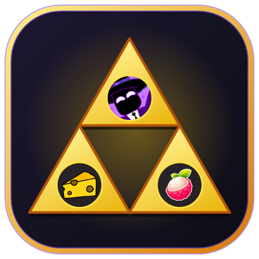

  

# FritCheeLii v3.0

**FritCheeLii** is a Switch & Switch 2 emulator built on C++ and tuned for **The Legend of Zelda: Ocarina of Time Remake**, combining the high-FPS / low-VRAM engine of **CheezyEmu** with the modern Graphite UX, floating top hover bar, and fused telemetry overlay of **Fritchii** and **Lichii**.

## Highlights in v3.0
- **High-FPS / Low-VRAM Engine:** ~25+ FPS and ~2.8 GB VRAM on 4 GB GPUs (GTX 1650) with native **OoT FSR 3D Scale Preset** (`Balanced / Performance / Quality / Native AA`), **AMD FSR 4**, **Frame Generation**, and **Find Best Settings for This PC**.
- **Fused Horizontal Gold FPS Overlay:** Big gold FPS, `ms` + `LOW`, vertical color-coded bar graph, live **CPU % + dynamic bottleneck status** (`Limited by VRAM / GPU / CPU / Capped / Balanced`), **GPU ms + `% busy`**, and **RAM / VRAM**.
- **Modern Graphite Theme & Clean Shader Loading Bar:** Sleek dark Graphite + Violet/Gold interface with floating top hover controls during gameplay and quick status bar toggles (`Graphics`, `Handheld/Docked`, `FSR`, `Volume`).
- **Universal Saves (`File → Saves (Import / Export)...`):** Clean Export & Import supporting Emulators, **NX2Navi**, **Hookshot / Longshot**, and `.zip` backups.
- **`Reset Shader Cache...`** in `Settings → Graphics → Advanced` + isolated **`Test` tab** (`4K Texture Mip Cap`).
- **Dynamic Portable Filesystem** & **Maximized window fix** on game launch.

## Installation
1. Download **`FritCheeLii-v3.0.zip`** from Releases.
2. Extract — it creates the **`FritCheeLii v3.0`** folder with **`FritCheeLii.exe`**.

## Credits
Built on GPL open-source software with advancements from **Fritchii**, **CheezyEmu**, **Lichii**, **Eden / Yuzu**, and **Dark (Dynamic FPS)**. Not affiliated with Nintendo.
